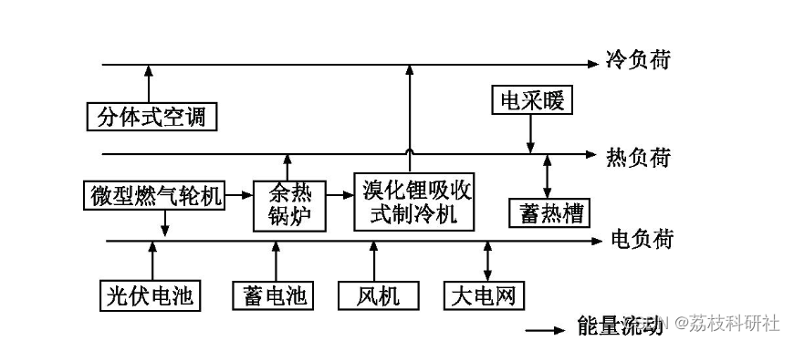
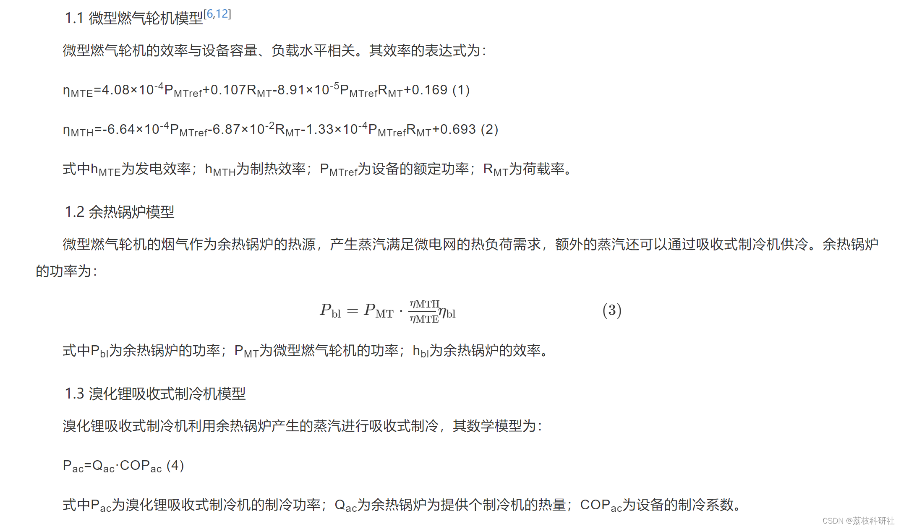
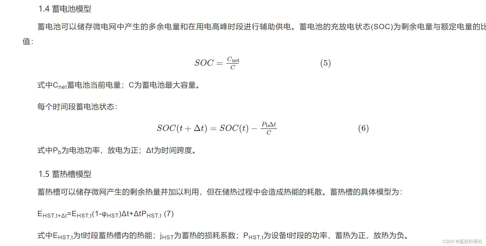
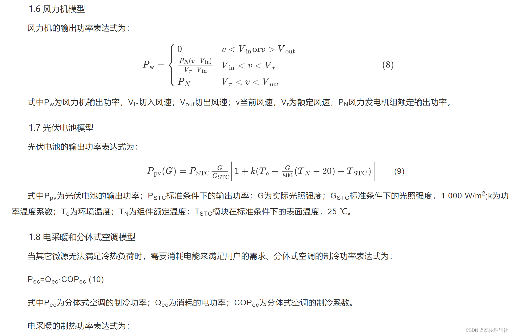
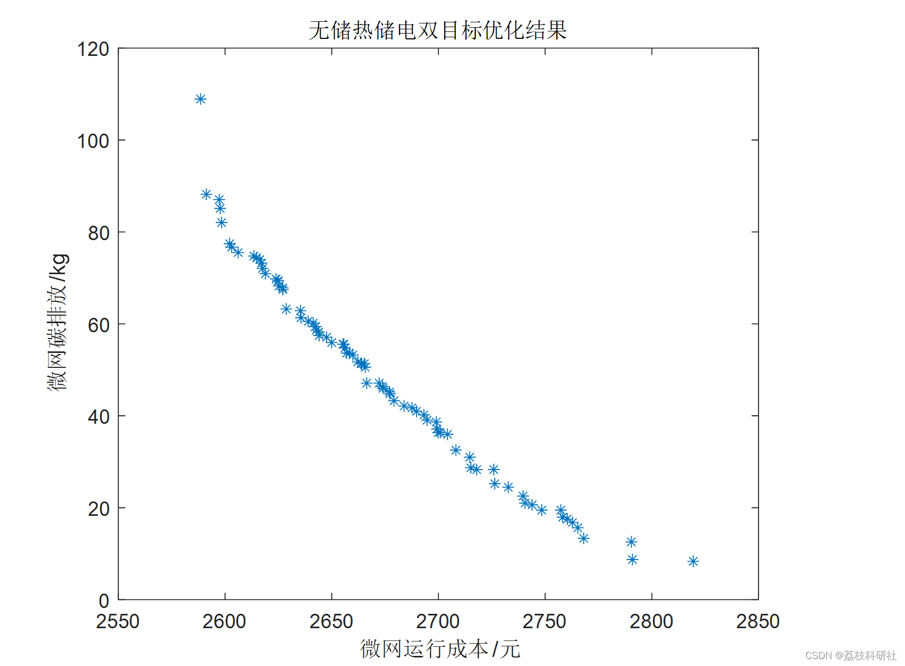
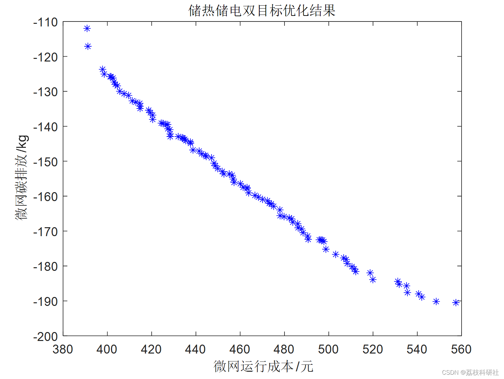
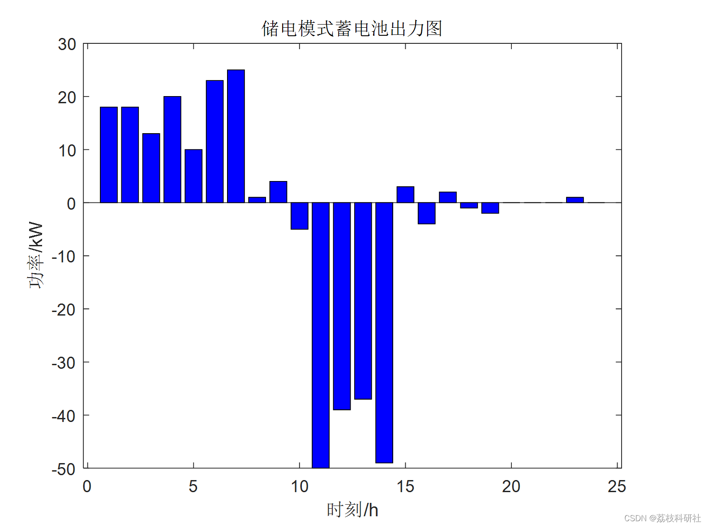
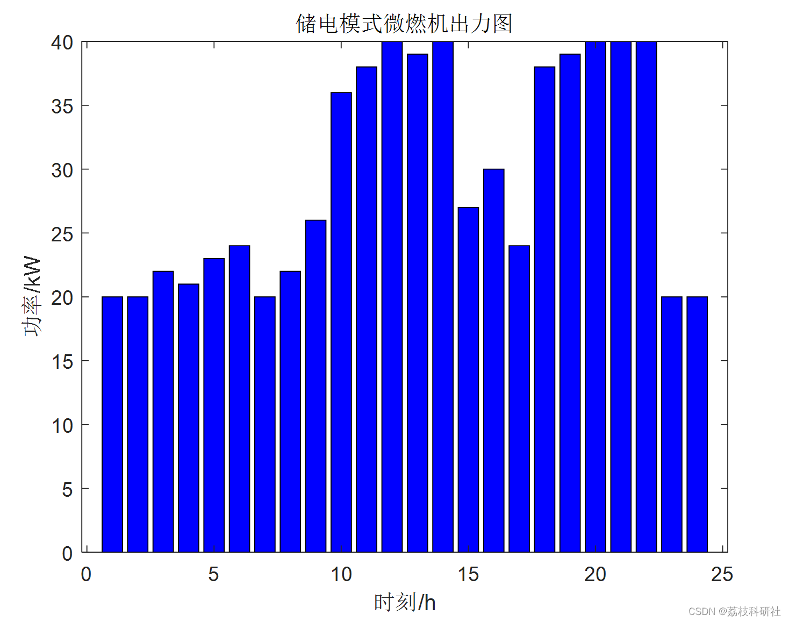
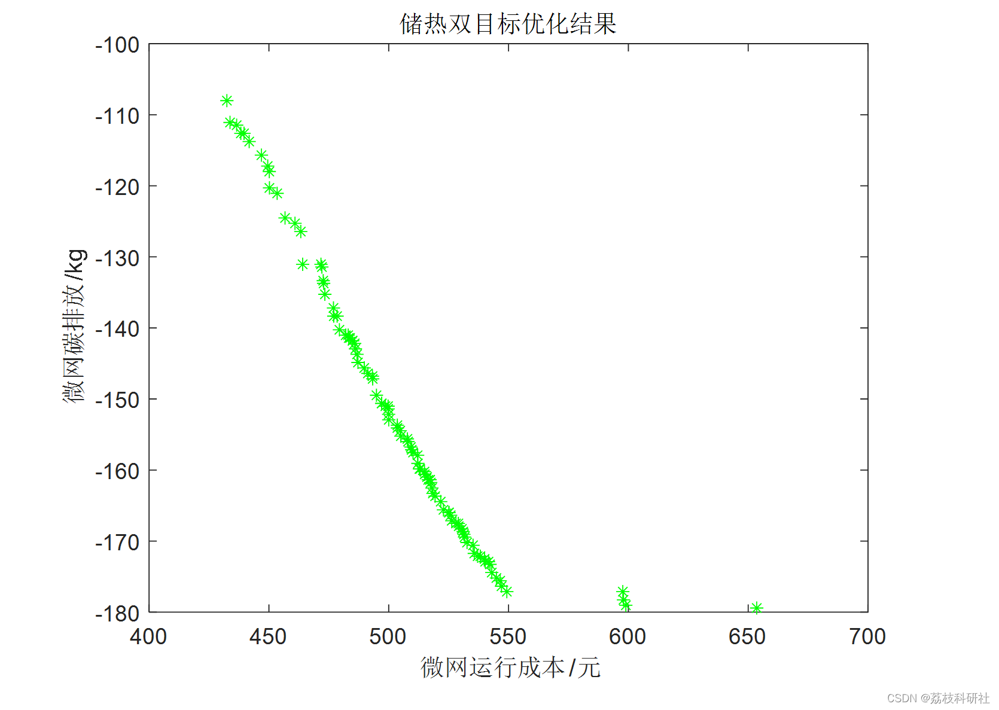
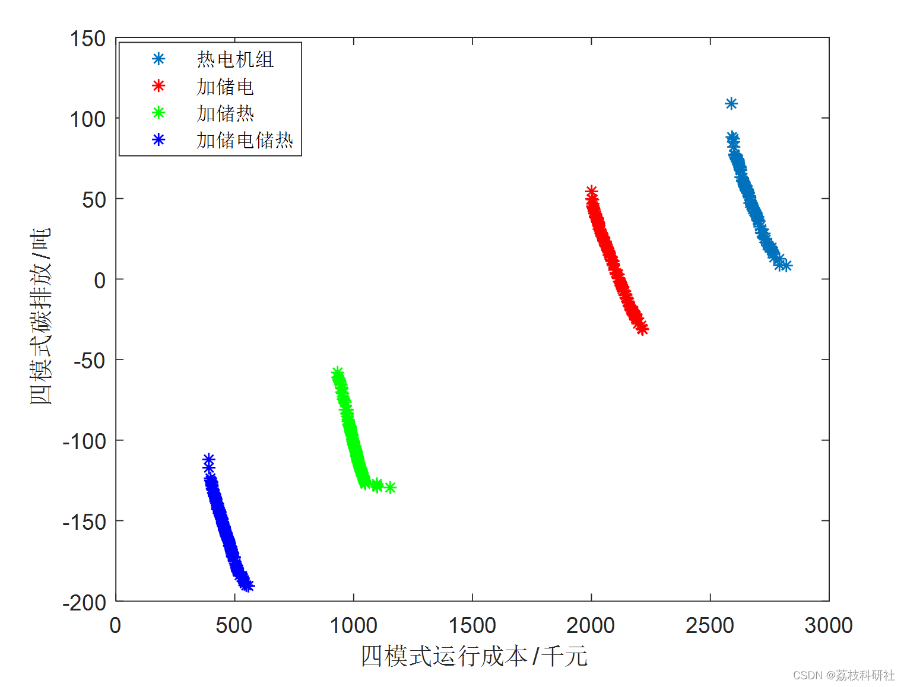

# Low-carbon Economic Dispatch of Cogeneration Microgrid Based on Multi-Objective Grey Wolf Algorithm (Matlab Code Implementation)

Based on the Multi-Objective Grey Wolf Algorithm for Cogeneration Microgrid Low Carbon Economical Dispatch (Matlab Code Implementation) [Complete Code Download] Study Society (ttaozhi.com)
Editor
With the rapid development of distributed energy supply systems, combined heat and power (CHP) systems and cogeneration (CCHP) systems have become key solutions to improve energy efficiency and reduce greenhouse gas emissions. CHP systems adopt the principle of energy cascade utilization, significantly improving the energy utilization efficiency of the system compared to conventional thermal power generation, achieving the goals of energy conservation and emission reduction. In-depth research on CCHP microgrids is dedicated to the coordinated operation of various energy systems, enhancing the economic and environmental sustainability of microgrid operations, which is of significant importance for the promotion and development of CCHP microgrids.
Currently, The economic dispatch of microgrids mainly considers the factors of economy and environmental protection. In the literature [4], a fuzzy geometric weighting method is adopted. The objective function of comprehensive operation cost and environmental penalty factor is established. Optimize the dispatch of CCHP microgrid. This method of transforming multi-objective problems into single objectives is widely used in the research on the operation optimization of microgrids. However, there are also certain issues. The operating strategy obtained by single-target optimization is single. Users are unable to make flexible choices. At the same time, The results of single-objective optimization cannot allow users to directly regulate the economic and environmental aspects of the operation strategy. Focus solely on the best economic benefits.In the literature [6], MOPSO is employed to optimize multi-objective operation of a combined heat and power (CHP) microgrid based on Pareto optimal solutions. The optimization results allow users to intuitively understand the specifics of pollution gas emissions and operational costs. The optimized results based on Pareto optimal solutions are diverse, allowing users to make optimal choices among various optimization strategies by balancing pollution gas emissions and operational costs in line with practical needs.
Editor
Editor
Editor
Editor
📚2 Running Results
Editor
Editor
Editor
Editor
Editor
Due to the length of this text, only a portion of the results is presented here.
function H_MT_h = MT_PE2H(MT_PE)  
Khe = 0.134; % Reverse heat coefficient
n_MT= 0.196 ;% MT power generation efficiency
% n1= 0.612; % System thermal loss coefficient
% Q_MT = MT_PE * (1 + n_MT - n1) / n_MT; % Calculates the exhaust heat residual of periodical micro-gas turbine.
H_MT_h=MT_PE/n_MT*Khe;  
end  
for i=1:GreyWolves_num  
for j=1:nVar/2  
r1=rand(); % r1 is a random number in [0,1]  
r2=rand(); % r2 is a random number in [0,1]  
A1 = 2 * a * r1 - a; % Calculate coefficient A, Equation (3.3)
C1 = 2*r2; % Calculate coefficient C, Equation (3.4)
% Alpha wolf position update
D_alpha=abs(C1*Alpha(1,j)-GreyWolves(i,j)); % Equation (3.5)-part 1  
X1=Alpha(1,j)-A1*D_alpha; % Equation (3.6)-part 1  
X1 = max( [min([ X1, ub(j) ] ) ,lb(j) ] );  
r1=rand();  
r2=rand();  
The following is the translation of the Chinese text into English:
A2 = 2*a*r1 - a; % Calculate coefficient A, Equation (3.3)  
C2 = 2*r2; % Calculate coefficient C, Equation (3.4)  
% Beta wolf position update  
D_beta = abs(C1*Beta(1,j) - GreyWolves(i,j)); % Equation (3.5)-part 1  
X2 = Beta(1,j) - A1*D_beta; % Equation (3.6)-part 1  
X2 = max([min([X2, ub(j)]),lb(j)] );  
r1 = rand();  
r2 = rand();  
A3 = 2*a*r1 - a; % Calculate coefficient A, Equation (3.3)  
C3 = 2*r2; % Calculate coefficient C, Equation (3.4)  
% Delta wolf position update  
D_delta = abs(C1*Delta(1,j) - GreyWolves(i,j)); % Equation (3.5)-part 1  
X3 = Delta(1,j) - A1*D_delta; % Equation (3.6)-part 1  
X3 = max([min([X3, ub(j)]),lb(j)] );  
% Position update  
GreyWolves(i,j) = (X1 + X2 + X3) / 3;% Equation (3.7)  
% Below is the handling of position limits  
GreyWolves(i,j) = floor(GreyWolves(i,j));  
end  
Soc = 10;
%Since 22 is the peak period, and 23 and 24 are off-peak hours, and there's a strong wind at night, I'm likely assuming that they're charging.
% After charging for two hours, it is 5 + 2.5 * 2 = 10kWh;
for j= 1+nVar/2 : nVar  
Probability =rand( );  
% Positions of the three wolves are divided into 0, 1, 2, and 3 for discussion, corresponding to different probabilities, facilitating convergence and optimization.
if Alpha(1,j)==Beta(1,j ) &&  Alpha(1,j)== Delta(1,j ) && (Probability < 0.5 + 0.25*it/MaxIt)  
GreyWolves(i,j)=Alpha(1,j);  
else  
mm= -1+rand()*2;  
% Add an integer ceil function to limit the result to -1, 0, and 1 three constants.
mm=round(mm);  
if mm==-1  
mm=-5;  
elseif mm==0  
mm=0;  
else  
mm=2.5;  
end  
GreyWolves(i,j)=mm;  
end  
%The above is the probability of success P_BA, which does not consider the issue of capacity limits. The following will address this.
Soc=Soc+GreyWolves(i,j) ;  
If Soc > 25 || Soc < 5%
Soc = Soc - GreyWolves(i, j); % Revoke capacity
GreyWolves(i,j) = 0; % Cancel power
end  
end  
GreyWolves(i,nVar+1:nVar+2)= Double_CC_fitness(GreyWolves(i,1:nVar/2), GreyWolves(i,1+nVar/2:nVar));  
end  
figure(1)  
Archive_Cost=Archive(:,49);  
Archive_Carbon=Archive(:,50);  
plot(Archive_Cost,Archive_Carbon,'o' );  
🎉3 References
🌈4 Matlab code implementation

## Images

<!-- PAYMENT_BLOCK -->

## Get this dataset

- Payment link (Stripe): [Buy now](https://buy.stripe.com/3cs8yP7sY87d0vu9AB)
- Payment QR code: 

<!-- /PAYMENT_BLOCK -->
